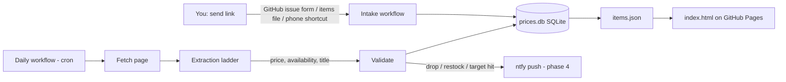

# Shopping price tracker — design & implementation plan

Status: **design / proposal**. Nothing is built yet; this document is the plan to review.

## 1. What it does

1. You send the app a product link (any online shop).
2. The app stores it in a small database and checks it **once a day**: current price and
   availability (in stock / out of stock / pre-order / unknown).
3. **Every price it gathers is kept permanently** (one record per item per check, never
   overwritten or deleted, including failed checks), so each item has a full price history.
4. A web page (GitHub Pages, like the other projects here) shows every tracked item:
   current price, lowest seen, availability, a small price-history chart, and when it was last checked.
   Clicking an item opens a **full price-history graph** (section 6).
5. **Categories / tags:** you can create tags (e.g. `electronics`, `gifts`, `kitchen`,
   `wishlist`) and give each item any number of them; the page filters and groups by tag (section 5).
6. Later: push notifications (ntfy, same as `library-new-item-tracker`) on a price drop,
   back in stock, or when a target price is reached.

## 2. Architecture

It follows the pattern already working in `library-new-item-tracker`: Python + SQLite,
run by a scheduled GitHub Actions workflow that commits the updated database and a JSON
file that a static `index.html` reads. No server to run or pay for.



### 2.1 The two hard problems (and they are separate)

**a) Fetching the page.** Many large retailers (Amazon, Walmart, Target, Best Buy) block
automated requests, especially from cloud IPs like GitHub Actions: you get a CAPTCHA,
a 403/503, or a stripped page. **An AI model does not fix this** — if we can't download
the real page, there is nothing for the AI to read. Options, cheapest first:

| Fetch method | Cost | Notes |
|---|---|---|
| Plain HTTP with browser-like headers (`curl_cffi`, which impersonates Chrome's TLS fingerprint) | free | Works for most small/medium shops and Shopify stores |
| Headless browser (Playwright/Chromium) | free, slower | For pages that only show the price after JavaScript runs |
| Claude's server-side `web_fetch` tool | API cost | Fetched from Anthropic's side; worth testing on blocked sites in the spike |
| Scraping API (ScraperAPI, ZenRows, Zyte, etc.) | paid, per request | Residential proxies + CAPTCHA handling; only for the sites that need it |
| Run the job on a home machine (e.g. Raspberry Pi) | free | Home IP is rarely blocked; GitHub Actions still serves the page |
| Retailer APIs (Amazon PA-API, Best Buy API, Keepa for Amazon history) | free–paid, needs keys | Most reliable where available, but per-retailer work |

**b) Reading price + availability from the page.** This is where we have choices besides AI:

### 2.2 Extraction ladder (cheap and exact first, AI last)

Each check tries these in order and stops at the first confident answer. The method used
is recorded with every check, so we can see what's actually working.

1. **Structured data (schema.org JSON-LD / microdata).** Most shops put a machine-readable
   `Product` → `Offer` block in the page for Google Shopping: `price`, `priceCurrency`,
   `availability` (`https://schema.org/InStock`, `OutOfStock`, `PreOrder`…). Free, exact,
   and covers a large share of shops (all Shopify stores, many others).
2. **Meta tags.** OpenGraph / Facebook product tags: `product:price:amount`,
   `og:price:amount`, `product:availability`.
3. **Site adapters** for important shops that need special handling, e.g. Shopify's
   `/products/<handle>.js` JSON endpoint, Next.js `__NEXT_DATA__` blobs (Walmart, Target),
   Amazon's `#corePrice` / `#availability` elements. Small, tested functions per site.
4. **Learned recipe.** When step 5 succeeds, the AI also returns *where* on the page the
   price and stock text were found (CSS selectors). We save that recipe per item and try it
   first next time — free and deterministic. If the recipe stops matching (site redesign),
   we fall back to step 5 and learn a new one. This means the AI is called roughly once per
   item, not once per day.
5. **AI extraction (Claude API).** Strip the page to its visible text plus relevant
   attributes (drop scripts, styles, nav, footer; keep roughly the main content, a few
   thousand tokens), send it with a strict JSON schema via structured outputs:
   ```json
   {"title": "...", "price": 129.99, "currency": "USD", "list_price": 159.99,
    "availability": "in_stock|out_of_stock|preorder|limited|unknown",
    "price_text": "$129.99", "price_selector": "...", "availability_selector": "...",
    "confidence": "high|medium|low"}
   ```

### 2.3 Validation (so we never notify on a wrong number)

- The AI's `price_text` must appear **verbatim** in the page text, or the answer is rejected
  (stops hallucinated prices).
- Prices are stored as integer cents plus a currency code.
- Big jumps (e.g. drop over 60% or rise over 3×) are treated as suspicious: re-check with a
  different method before saving as real or notifying.
- A failed check (blocked, timeout, nothing found) is saved as a failed check with the
  error, never as "price = 0" or "out of stock".
- Variants (size/colour) are a known trap: the page's default variant may differ from the
  one you want. The URL is kept exactly as sent (Shopify `?variant=`, Amazon ASIN) and
  adapters respect it.

## 3. Data model (SQLite, `prices.db`)

```text
items
  id               INTEGER PK
  url              TEXT  -- exactly as sent
  canonical_url    TEXT  -- tracking params stripped; used to avoid duplicates
  retailer         TEXT  -- domain, e.g. "bestbuy.com"
  title            TEXT
  image_url        TEXT
  currency         TEXT
  target_price_cents INTEGER NULL   -- optional "tell me below this"
  recipe_json      TEXT NULL        -- learned selectors (2.2 step 4)
  active           INTEGER          -- 0 = paused/removed, history kept
  added_at, notes

tags
  id               INTEGER PK
  name             TEXT UNIQUE      -- stored lowercase, e.g. "electronics"
  color            TEXT NULL        -- optional, for the badge on the page
  created_at

item_tags                            -- many-to-many: an item can have any number of tags
  item_id          INTEGER  -> items.id
  tag_id           INTEGER  -> tags.id
  PRIMARY KEY (item_id, tag_id)

checks                               -- one row per item per run: THE PRICE HISTORY
                                     -- append-only: rows are never updated or deleted,
                                     -- even when an item is untracked (active = 0)
  id, item_id, checked_at
  ok               INTEGER
  price_cents      INTEGER NULL
  list_price_cents INTEGER NULL      -- "was" price, if shown
  availability     TEXT              -- in_stock | out_of_stock | preorder | limited | unknown
  method           TEXT              -- jsonld | meta | adapter:<name> | recipe | llm
  fetch_method     TEXT              -- http | browser | web_fetch | scraper_api
  http_status, error TEXT NULL

events                               -- what we notified about (dedupe + history)
  id, item_id, created_at
  kind             TEXT              -- price_drop | back_in_stock | target_hit | check_failing
  old_price_cents, new_price_cents, sent INTEGER
```

Each run also exports, for the web page:
- `items.json` — every item with its current state, tags, lowest/highest/average price,
  and a short recent history for the card sparkline;
- `history/<item_id>.json` — that item's **complete** price history (every successful
  check: date, price, list price, availability), loaded only when you open its graph, so
  the main page stays small as history grows for years.

Size check: 50 items × 1 check a day × 5 years ≈ 91,000 rows, a few MB of SQLite — fine to
keep in the repo indefinitely.

## 4. Sending links to the app

Recommended, in the order we'd build them:

1. **`items.txt` in the repo** — one line per item:
   `URL | tags: electronics, gifts | target: 99.99 | note: for Dad`
   (everything after the URL is optional). Simplest; good for the spike and MVP. Tags named
   here are created automatically if they don't exist yet.
2. **GitHub issue form "Track an item"** — open an issue from the GitHub phone app, paste
   the link, and pick or type tags. A workflow on `issues: opened` adds it, runs a first
   check right away, replies with the detected title/price/availability, and closes the
   issue. Companion forms: "Untrack an item" and "Edit item" (change tags, target, note).
3. **Phone share sheet** — an iOS Shortcut / Android "HTTP Shortcuts" action that sends the
   shared URL to GitHub's `repository_dispatch` API (needs a fine-grained token on the
   phone limited to this repo). Share any product page → it's tracked.

## 5. Categories / tags

- **Tags, not fixed categories:** an item can have several tags (a TV can be both
  `electronics` and `black-friday`). A single "category" is just using one tag per item.
- **Creating tags:** any tag used on an item is created automatically. Tags can also be
  created ahead of time, renamed, recoloured, merged or deleted, via a `tags.txt` file
  (`name | color`) or a "Manage tags" issue form. Deleting a tag removes it from items but
  never deletes the items or their history.
- **Tagging items:** when adding an item (section 4), or later with "Edit item".
- **On the page:** tag chips at the top filter the list (pick several to combine);
  an optional "group by tag" view shows one section per tag with a per-tag count and
  total current value; untagged items get their own group.
- Tags are also sent with notifications (e.g. "[gifts] Lego set dropped to $79"), and in
  a later phase notification rules can be set per tag (e.g. only notify for `wishlist`).

Why not edit tags directly on the web page? GitHub Pages is static and can't write to the
database. If editing from the page matters to you, the page can open a pre-filled
"Edit item" issue with one click, which keeps everything in the same workflow.

## 6. Price-history graph

- **Card sparkline:** small line of the last 90 days on every item card on the main page.
- **Item detail view** (click a card): a full-size interactive chart built from
  `history/<item_id>.json`:
  - price over time as a step line (price holds until the next check);
  - "was"/list price as a faint second line where the shop shows one;
  - out-of-stock periods shaded, failed checks shown as gaps (not as zero);
  - lowest-ever and target price as horizontal reference lines;
  - range buttons: 1M / 3M / 6M / 1Y / All; hover shows date, price, availability;
  - summary under the chart: current, lowest (and when), highest, average, change vs. 30 days ago;
  - the full table of every recorded check, with a CSV download.
- Built with a small charting library loaded from a CDN (e.g. Chart.js), light and dark themes,
  works on a phone.

## 7. Notifications (phase 4)

Reuse the `notify.sh` + ntfy setup from `library-new-item-tracker`, with its own secret
(`SHOPPING_PRICE_TRACKER_NTFY_TOPIC`). Rules:

- **Price drop:** at least 5% *or* $5 below the last price we notified about (configurable),
  so small wobbles don't spam.
- **New low:** lowest price in the item's history.
- **Target hit:** price at or below the item's target.
- **Back in stock:** previous successful check was out of stock, now in stock.
- **Check failing:** an item failed 3 days in a row (link dead or site blocking).
- Plus a weekly summary that doubles as a heartbeat, like the PS5 tracker.

## 8. Proposed files

```text
shopping-price-tracker/
  README.md            this document
  items.txt            links to track (MVP intake)
  tracker.py           daily run: load items, check each, save, export items.json
  db.py                schema + queries
  fetch.py             http (curl_cffi) -> browser (Playwright) fallbacks
  extract/
    structured.py      JSON-LD, microdata, meta tags
    adapters.py        per-site handlers (shopify, next_data, amazon, ...)
    recipe.py          apply / learn CSS-selector recipes
    llm.py             Claude structured-output extraction + verbatim check
  validate.py          sanity rules from 2.3
  notify.sh            ntfy (phase 4)
  tags.txt             optional: predefined tags and colours
  spike.py             phase 0 experiment runner
  index.html           web page: item list, tag filters, price-history graph
  items.json, history/, prices.db  generated, committed by the workflow
  test_*.py            tests with saved HTML fixtures (no network in tests)
.github/workflows/
  price-tracker.yml       daily cron + manual run
  price-tracker-intake.yml  issue form / repository_dispatch intake (phase 3)
```

## 9. Implementation plan

### Phase 0 — Spike: find out what actually works (do this first)
- You send 10–20 real links from the shops you actually use.
- `spike.py` runs every fetch method × every extraction method on each link, from GitHub
  Actions (cloud IP) and from this dev container, and prints a table: blocked? which method
  found the price? did it match the real price?
- **Decision output:** which shops work for free, which need the AI step, which need a
  browser or a paid fetch service. This decides how much of phases 2/5 we need.

### Phase 1 — MVP tracker (no AI)
- SQLite schema (items, tags, item_tags, append-only checks), `items.txt` intake with tags,
  URL canonicalisation and dedupe.
- Fetch with `curl_cffi`, Playwright fallback.
- Structured data + meta tag extraction, a couple of adapters for shops from the spike.
- Validation rules, failed checks recorded properly.
- Daily GitHub Actions workflow that commits `prices.db`, `items.json` and `history/`.
- Tests with saved HTML fixtures.

### Phase 2 — AI fallback + learned recipes
- `llm.py`: page-to-text trimming, Claude call with structured outputs, verbatim price check.
- Recipe learning and reuse; re-learn on breakage.
- Per-run AI call cap and cost log in the run summary.
- API key as a repository secret (`ANTHROPIC_API_KEY`); the AI step is skipped if unset.

### Phase 3 — Web page + easier intake
- `index.html`: item cards (image, title, shop, tags, price, change vs. last week, lowest
  seen, availability badge, sparkline, last checked, link), sort, tag filter chips and
  group-by-tag view, light/dark theme; card added to the repo's home page.
- Item detail view with the full price-history graph and history table (section 6).
- Issue forms: Track / Untrack / Edit item / Manage tags, with an immediate first check and a reply.
- Optional share-sheet shortcut instructions.

### Phase 4 — Notifications
- `notify.sh` + rules in section 7, `events` table for dedupe, weekly summary/heartbeat,
  failure alerts.

### Phase 5 — Hardening (only as needed after real use)
- Paid fetch service or home-machine runner for blocked shops.
- More adapters for frequently used shops.
- Currency handling if non-USD shops are added.

## 10. AI cost estimate

Default model per our Claude setup is Claude Opus 5.5 (`claude-opus-5-5`, $4 / $20 per
million input/output tokens). A trimmed page of ~8,000 tokens in and ~300 out costs about
**$0.04 per AI extraction**. Claude Haiku 5.5 (`claude-haiku-5-5`, $0.10 / $0.50) would be
about **$0.001** — worth comparing in the spike, since this is a simple extraction task.
Because of learned recipes and structured data, most daily checks use no AI at all; with
30 items, expect a few AI calls a week (initial learning + site redesigns), i.e. cents per
month. A hard daily cap keeps a bad day from costing more.

## 11. Things to decide

1. **Which shops** you mainly buy from (decides adapters and whether blocking is a problem).
2. **Public repo:** the tracked links and prices would be visible on GitHub and the page.
   Fine for shopping, but a private repo is an option.
3. **AI model:** Opus 5.5 (default) vs. Haiku 5.5 (much cheaper) — the spike can compare accuracy.
4. **Paid fetching:** OK to use a scraping service for blocked shops if the spike shows it's needed?
5. **Intake:** start with `items.txt` + issue form, or do you want the phone share-sheet from the start?
6. **Tags:** any starting set of tags you already know you want (e.g. electronics, home, gifts, wishlist)?
